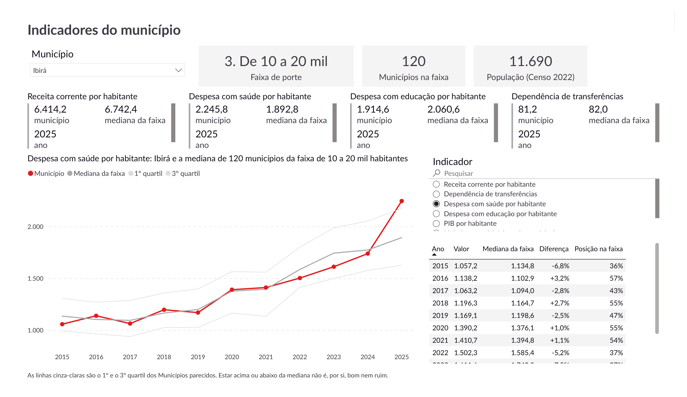
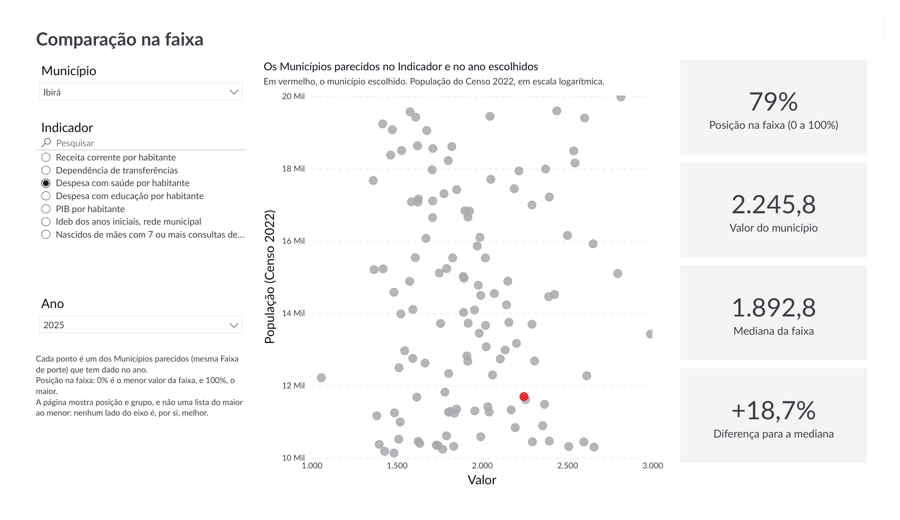
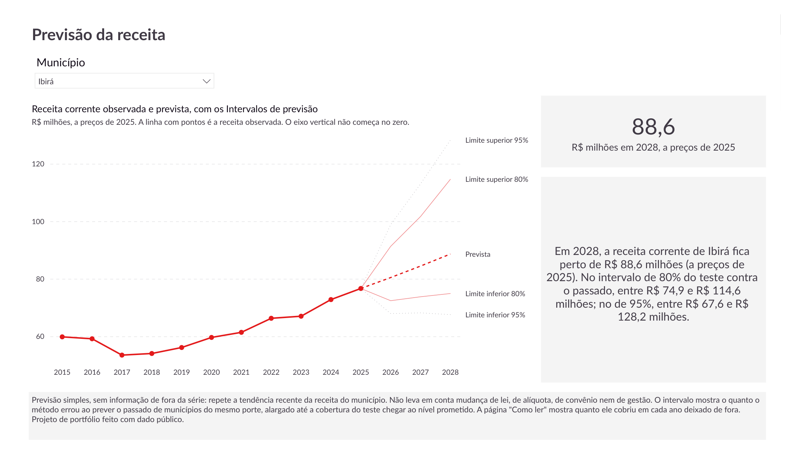
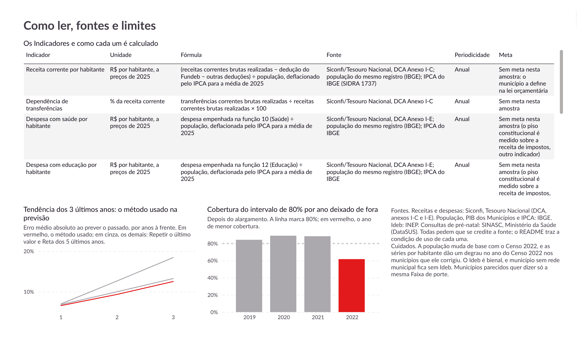
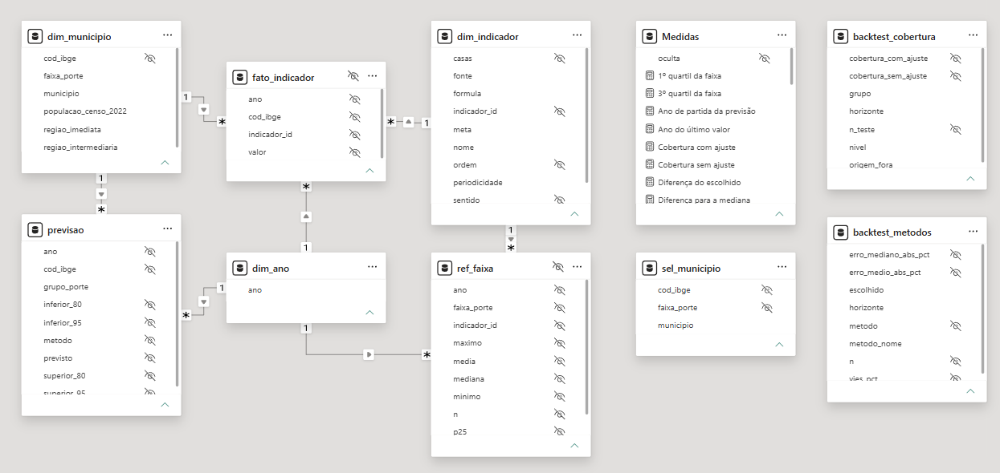
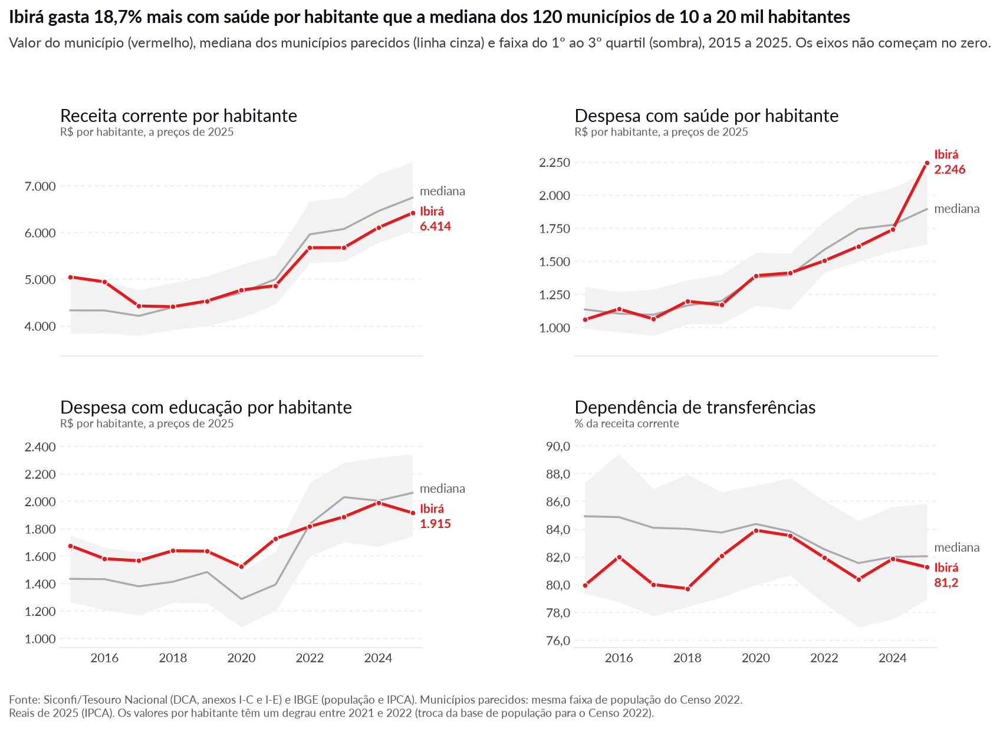
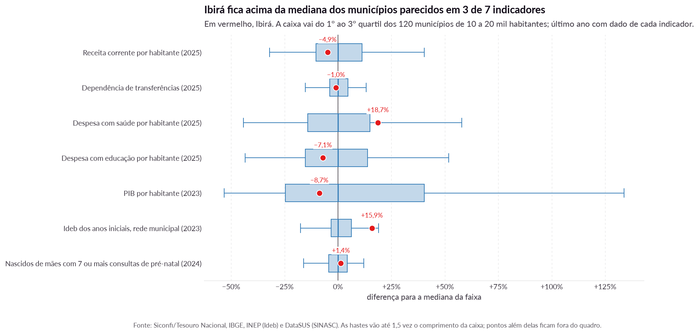
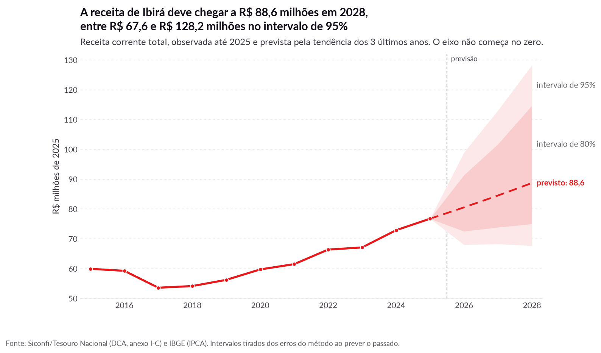
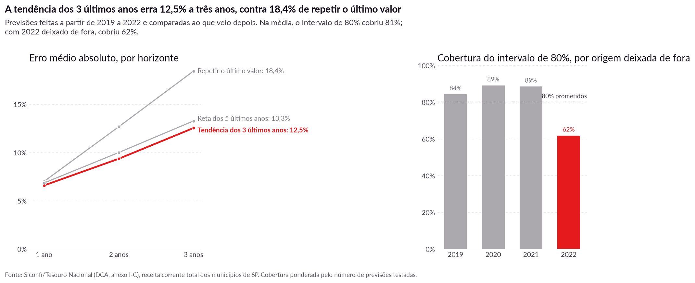

# Indicadores dos municípios de SP: onde cada município está entre os do mesmo porte?

Um painel de Power BI e uma planilha Excel sobre uma pergunta direta: **onde um município paulista está, em 8 Indicadores de finanças, educação, saúde e economia, comparado aos municípios do mesmo porte, e quanto de receita ele pode esperar nos próximos anos?** A comparação cobre os 645 municípios de São Paulo, de 2015 a 2025, só com dado público e agregado por município.

| | |
|---|---|
| **Dados** | Dado público de quatro órgãos, 2015 a 2025: contas anuais dos municípios (DCA do Siconfi, Tesouro Nacional), população, PIB e IPCA (IBGE), Ideb (INEP) e nascidos vivos (SINASC, DataSUS) |
| **Painel** | **50.413 valores** de município × ano × Indicador, dos 645 municípios, onde há dado; saíram 27 valores declarados, de 15 municípios, com critérios documentados |
| **Métodos** | Indicadores refeitos em SQL e conferidos por uma segunda implementação em pandas; comparação com a Mediana da faixa e a Posição na faixa; Previsão da receita por tendência, com Intervalo de previsão calibrado no Teste contra o passado |
| **Entrega** | Painel de Power BI (PBIP) de 4 páginas, com visuais definidos em código (PBIR) sobre modelo em TMDL; planilha Excel gerada por script em Python e completada no Excel para a web, com passo a passo para refazer à mão; relatório curto em LaTeX |
| **Ferramentas** | Power BI Desktop (Power Query, DAX, TMDL, PBIR), Excel para a web (PROCX, LET, SEQUÊNCIA, tabela dinâmica e segmentação), SQL (SQLite), Python (pandas, matplotlib, XlsxWriter) e LaTeX |

## Principais resultados

Os números abaixo saem dos dados tratados e dos resultados das conferências gravados no repositório. A fonte de cada número impresso está em `NUMEROS_CANONICOS.md`. O município de exemplo, Ibirá, foi sorteado com semente fixa entre os 521 municípios de série completa.

- **O município de exemplo contra os parecidos.** Ibirá **gasta 18,7% mais com saúde por habitante** que a mediana dos 120 municípios da faixa de 10 a 20 mil habitantes, em 2025. No último ano de cada Indicador, fica acima da Mediana da faixa em **3 de 7**, e o mais perto de uma ponta é o Ideb dos anos iniciais, rede municipal, na Posição na faixa de **92%**.
- **O DAX devolve os números do SQL.** As medidas do modelo, rodadas no Power BI Desktop, acertaram **174 de 174 células** da tabela de conferência (3 municípios sorteados). Na conferência completa, Valor, Mediana da faixa e Posição na faixa das 50.413 linhas da base somam **151.239 células, com 0 divergências** contra o SQLite.
- **A planilha também.** As fórmulas da aba Painel e da aba Previsão, calculadas pelo Excel para a web, deram **256 de 256 células** iguais ao SQLite, em 4 municípios.
- **A previsão erra menos que repetir o último valor.** A tendência dos três últimos anos erra **12,5%** a três anos, contra 18,4% de repetir o último valor. Para Ibirá, a receita corrente deve chegar a **R$ 88,6 milhões em 2028** (a preços de 2025), entre R$ 67,6 e R$ 128,2 milhões no Intervalo de previsão de 95%.
- **O intervalo cobre o que promete na média, e não em todo ano.** O Intervalo de previsão de 80% cobriu **81%** dos casos no Teste contra o passado, mas só **62%** com a origem de 2022 deixada de fora. Por isso, a leitura prudente é a do intervalo de 95%.

## O painel

O painel abre no Power BI Desktop, a partir de `powerbi/painel-municipios-sp.pbip`. Os visuais são definidos em código (PBIR) sobre modelo em TMDL: `scripts/gerar_relatorio_pbi.py` escreve as páginas, e `powerbi/roteiro.md` diz o que cada uma mostra. As capturas mostram Ibirá.


*Município: Faixa de porte, último valor de quatro Indicadores ao lado da Mediana da faixa, e a série do Indicador escolhido contra a mediana e os quartis.*


*Comparação na faixa: cada ponto é um dos Municípios parecidos, e o escolhido sai em vermelho. Mostra posição e grupo, e nunca um ranking por nome.*


*Previsão da receita: receita observada, prevista e os dois Intervalos de previsão, com a frase em reais e o aviso do que a previsão não considera.*


*Como ler, fontes e limites: a definição escrita de cada Indicador, o erro dos métodos de previsão e a cobertura por ano deixado de fora.*


*Visão de modelo: 3 tabelas fato e 3 dimensões em estrela, com 7 relações de um para muitos e direção única, e 39 medidas DAX em pastas de exibição.*

## As figuras

As figuras saem de `scripts/graficos.py`, no estilo do portfólio. O título de cada uma afirma o achado, e o número do título sai do registro.


*Ibirá contra a Mediana da faixa e os quartis, em quatro Indicadores, de 2015 a 2025.*


*A diferença de Ibirá para a Mediana da faixa nos 7 Indicadores comparáveis, sobre a distribuição dos Municípios parecidos.*


*A Previsão da receita de Ibirá até 2028, com os Intervalos de previsão de 80% e de 95%.*


*O Teste contra o passado: erro de cada método por horizonte e cobertura do intervalo de 80% em cada origem deixada de fora.*

## Como o trabalho foi feito

1. **Coleta.** Quatro scripts baixam os dados das APIs e dos arquivos públicos: Siconfi (Tesouro) e lista de municípios (IBGE), SIDRA (IBGE), Ideb (INEP) e SINASC (DataSUS). Cada um grava um CSV pequeno em `dados/brutos/` e retoma de onde parou.
2. **Base em SQL.** `scripts/construir_base.py` carrega os CSV num SQLite e roda as consultas de `sql/` em ordem: esquema, dimensões, os 8 Indicadores (JOINs, CTEs e funções de janela) e a referência por Faixa de porte (mediana e quartis). Os valores em reais vão a preços de 2025, pelo IPCA médio do ano. A regra de qualidade da declaração está na seção abaixo.
3. **Conferência da base.** `scripts/validar.py` refaz cada Indicador em pandas, a partir do CSV bruto e sem olhar o SQL, e compara linha a linha: a diferença máxima é zero. Os quartis por faixa são refeitos com NumPy. O relatório fica em `dados/tratados/validacao.txt`.
4. **Previsão da receita.** `scripts/modelo.py` testa três métodos simples, todos com a série do próprio município, prevendo o passado a partir de 4 origens (2019 a 2022):

   | Método | Erro médio, um ano à frente | Dois anos | Três anos | Viés a três anos |
   |---|---|---|---|---|
   | Repetir o último valor | 7,0% | 12,7% | 18,4% | +18,2% |
   | **Tendência dos três últimos anos (escolhido)** | **6,6%** | **9,4%** | **12,5%** | **+5,2%** |
   | Reta dos cinco últimos anos | 6,8% | 10,0% | 13,3% | +9,1% |

   O Intervalo de previsão não sai de uma fórmula de erro normal: sai dos erros que o método cometeu no Teste contra o passado, por horizonte e por Grupo de porte. Como a receita dos municípios se move junta (inflação, ICMS, transferências), as origens são, na prática, poucos choques, e não centenas de observações independentes. Por isso o intervalo foi conferido deixando uma origem de fora e alargado até cobrir o nível prometido:

   | Intervalo | Cobertura sem ajuste | Fator de alargamento | Cobertura com ajuste | Pior origem deixada de fora |
   |---|---|---|---|---|
   | 80% | 71% | 1,25 | 81% | 62% (2022) |
   | 95% | 92% | 1,15 | 95% | 91% (2022) |

5. **Modelo do Power BI em TMDL.** O modelo semântico (`powerbi/painel-municipios-sp.SemanticModel/`) é texto, revisável linha a linha no GitHub: 3 tabelas fato (valores, referência da faixa e previsão) e 3 dimensões (município, Indicador e ano), com 7 relações de um para muitos e direção única. O Power Query do modelo tem um parâmetro de pasta, uma função que lê qualquer CSV do projeto e uma consulta por tabela. As 39 medidas DAX ficam numa tabela só de medidas, em pastas de exibição. A Faixa de porte chega à referência por `TREATAS` ([registro de decisão](docs/adr/0001-ref-faixa-como-segunda-fato.md)).
6. **Páginas em PBIR.** `scripts/gerar_relatorio_pbi.py` escreve as 4 páginas, um JSON por visual, com campos, formato, texto alternativo e ordem de tabulação ([registro de decisão](docs/adr/0003-visuais-do-painel-em-codigo.md)). O tema sai das cores e da fonte do kit (`scripts/gerar_tema.py`). Os testes conferem, sem o Desktop, que todo campo existe no modelo, que todo visual tem texto alternativo e que nenhum visual ordena municípios por nome.
7. **Conferência das medidas.** `scripts/gerar_conferencia.py` escreve, a partir do SQLite, o que cada medida tem de devolver para 3 municípios (`powerbi/conferencia.md`). Com o painel aberto no Power BI Desktop, `scripts/conferir_powerbi.py` roda as medidas no modelo e compara: 174 de 174 células batem. Com `--completo`, compara Valor, Mediana da faixa e Posição na faixa de todos os municípios e anos: 151.239 células, 0 divergências.
8. **Planilha.** `scripts/montar_excel.py` gera o `.xlsx` em Python: os CSV em cinco tabelas nomeadas, as fórmulas com PROCX, LET e SEQUÊNCIA, as listas de escolha e os gráficos. A planilha é completada no Excel para a web, onde entram a tabela dinâmica e a segmentação da aba Explorar e onde as fórmulas são calculadas. `scripts/conferir_excel.py` lê os valores calculados de uma cópia por município e compara com o SQLite: 256 de 256 células batem. O Power Query está no modelo do Power BI (TMDL), e não na planilha, porque o Excel para a web não tem "Obter Dados" ([registro de decisão](docs/adr/0004-planilha-sem-power-query.md)). O passo a passo para refazer a planilha à mão está em `excel/PASSO_A_PASSO.md`.
9. **Números e textos.** `scripts/numeros.py` calcula todo número impresso e monta este README a partir de `docs/README.modelo.md`. `scripts/verificar_textos.py` falha se algum número estiver digitado, pendente ou fora do registro, e se o relatório não compilar.

O caminho de um número é sempre o mesmo: fonte bruta, CSV de `dados/brutos/`, consulta em `sql/20_indicadores.sql`, `dados/tratados/indicadores_longo.csv`, tabela `tFato` da planilha e medida DAX do modelo.

## Qualidade do dado: o que saiu e por quê

A DCA é autodeclarada, e alguns municípios declararam, em certos anos, valores várias vezes menores que os dos próprios outros anos. A regra é igual para todos: valor zero ou negativo sai; em reais de 2025, o valor de um ano menor que um quarto ou maior que quatro vezes a média dos **outros** anos do mesmo município sai. A regra compara o município com ele mesmo, e não com a faixa: um município de royalties (Ilhabela) tem receita alta em todos os anos e fica. Saíram **27 valores de 15 municípios**, de 7.095 declarações possíveis, todos listados em `dados/tratados/exclusoes_declaracao.csv`. Fora isso, município que não entregou a declaração fica sem valor, e nada foi imputado.

Na conferência da base (`dados/tratados/validacao.txt`), cada Indicador refeito em pandas bate com o SQL linha a linha, os quartis por faixa batem com o NumPy e a população que o Siconfi grava bate com a do IBGE nos anos de mesma base.

## Como reproduzir

Precisa de Python 3.12 ou mais novo e de internet. Os passos marcados com **[Power BI Desktop]** e **[Excel para a web]** são feitos nesses programas; o resto roda no terminal, na raiz do repositório. A coleta do Siconfi leva horas, porque a API do Tesouro limita a taxa de pedidos; o resto leva minutos.

1. Instale as dependências:
   ```
   python -m venv .venv
   .venv/Scripts/pip install -r requirements.txt
   ```
2. Colete os dados brutos. Cada script grava em `dados/brutos/` e retoma de onde parou. A pasta fica fora do git, porque os arquivos baixados (`.dbc` do DataSUS e a planilha do INEP) passam de centenas de megabytes.
   ```
   .venv/Scripts/python scripts/coletar_sidra.py
   .venv/Scripts/python scripts/coletar_ideb.py
   .venv/Scripts/python scripts/coletar_sinasc.py 2015 2024
   .venv/Scripts/python scripts/coletar_siconfi_ibge.py 2015 2025
   ```
3. Monte a base, a previsão e a conferência da base (os dois primeiros leem e gravam `dados/tratados/`; a conferência relê `dados/brutos/`):
   ```
   .venv/Scripts/python scripts/construir_base.py
   .venv/Scripts/python scripts/modelo.py
   .venv/Scripts/python scripts/validar.py
   ```
4. Gere a tabela de conferência do Power BI, as figuras, o tema e as páginas do painel, com o Power BI Desktop fechado:
   ```
   .venv/Scripts/python scripts/gerar_conferencia.py
   .venv/Scripts/python scripts/graficos.py
   .venv/Scripts/python scripts/gerar_tema.py
   .venv/Scripts/python scripts/gerar_relatorio_pbi.py
   ```
5. **[Power BI Desktop]** Abra `powerbi/painel-municipios-sp.pbip`, troque o parâmetro `PastaDados` se o repositório estiver em outra pasta e atualize (`powerbi/roteiro.md`, seção "Antes de abrir"). Com o Desktop aberto, confira as medidas:
   ```
   .venv/Scripts/python scripts/conferir_powerbi.py --completo
   ```
6. **[Power BI Desktop]** Exporte as páginas para `powerbi/capturas/paginas.pdf` e corte uma imagem por página; a captura da visão de modelo é feita à mão (`powerbi/roteiro.md`, seção "Capturas"):
   ```
   .venv/Scripts/python scripts/capturas.py
   ```
7. Gere a planilha:
   ```
   .venv/Scripts/python scripts/montar_excel.py
   ```
8. **[Excel para a web]** Suba `excel/painel-municipios-sp.xlsx`, insira a tabela dinâmica e a segmentação da aba Explorar e baixe uma cópia calculada para cada município da conferência em `excel/calculadas/` (`excel/PASSO_A_PASSO.md`, seções "A aba Explorar" e "Baixar a cópia calculada"). Depois confira:
   ```
   .venv/Scripts/python scripts/conferir_excel.py
   ```
9. Gere os números, este README e o relatório, e confira os textos e os testes:
   ```
   .venv/Scripts/python scripts/numeros.py
   .venv/Scripts/python scripts/verificar_textos.py
   .venv/Scripts/python -m unittest discover -s tests
   ```

A base tratada (`dados/tratados/`), os resultados das conferências e todas as saídas derivadas estão versionados. Por isso, o painel, a planilha e os números podem ser refeitos a partir do quarto passo, sem coletar os dados de novo.

## Estrutura do repositório

| Caminho | O que é |
|---|---|
| `scripts/` | coleta, base, previsão, conferências, figuras, painel, planilha, números e verificador |
| `sql/` | as consultas comentadas que refazem cada Indicador |
| `dados/tratados/` | a base tratada em CSV e em SQLite, as exclusões e o Teste contra o passado |
| `powerbi/` | o projeto PBIP (modelo em TMDL e páginas em PBIR), o roteiro, a tabela e os resultados da conferência |
| `excel/` | a planilha, as cópias calculadas, o passo a passo e o resultado da conferência |
| `graficos/` | as figuras |
| `relatorio/` | o relatório em LaTeX e os números como macros |
| `docs/adr/` | as decisões registradas |
| `estilo/` | cópia do kit de estilo do portfólio (não se edita aqui) |
| `GLOSSARY.md` | o vocabulário: Faixa de porte, Municípios parecidos, Mediana da faixa e os demais |
| `NUMEROS_CANONICOS.md` | de onde sai cada número impresso |

## Limitações

- **Comparar não é julgar.** Estar acima ou abaixo da Mediana da faixa não é, por si, bom nem ruim: nenhum Indicador tem um lado melhor que valha para todo município. A comparação é descritiva e não diz por que um município difere dos outros.
- **Municípios parecidos é só porte.** São os da mesma Faixa de porte do Censo 2022 (7 faixas). Dois municípios do mesmo porte podem ser muito diferentes em turismo, indústria ou região metropolitana.
- **Degrau do Censo.** A população dos anos antes do Censo 2022 projeta o Censo 2010, e a dos anos seguintes vem do Censo 2022. Os Indicadores por habitante saltam no ano do Censo 2022 nos municípios que ele corrigiu. A receita total, que a previsão usa, não tem o degrau.
- **População do ano depois do Censo.** O IBGE não tem estimativa desse ano na tabela usada, e a população que o Siconfi grava nele é a de antes do Censo. Usei a média entre o Censo 2022 e a estimativa do ano seguinte, marcada na coluna `origem` de `populacao.csv`. É a única população que não vem pronta do IBGE.
- **Séries incompletas.** O Ideb é bienal, e município sem rede municipal fica sem Ideb. O PIB dos Municípios termina em 2023. No pré-natal, município com poucos nascidos com consulta informada no ano fica de fora (o corte está em `sql/20_indicadores.sql`).
- **A previsão não conhece o que vem de fora da série.** Não leva em conta mudança de lei, de alíquota, de convênio nem de gestão. Com 4 origens no Teste contra o passado, o ajuste do intervalo é grosseiro, e na origem de 2022, depois de um salto de receita, o intervalo de 80% cobriu só 62%.
- **O painel vive no PBIP.** Ele abre no Power BI Desktop, e uma mudança feita no Desktop se perde na próxima geração das páginas: quem muda uma página muda o gerador. A conferência das medidas precisa do Desktop aberto.
- **A planilha não se atualiza sozinha.** Sem Power Query, dado novo pede rodar o script de novo e refazer a tabela dinâmica. A conferência lê os valores que o Excel para a web calculou nas cópias baixadas.

## Fontes e licenças

Consulta feita em 14/10/2026. "Lido" quer dizer que o texto foi lido nesse dia; onde não consegui ler o texto de licença, está dito.

| Base | Órgão | Condição de uso encontrada | Situação |
|---|---|---|---|
| DCA, anexos I-C e I-E (Siconfi) | Tesouro Nacional | A página de APIs diz que os dados são "disponibilizados para livre utilização" ([gov.br/tesouronacional, APIs](https://www.gov.br/tesouronacional/pt-br/central-de-conteudo/apis)). Sem instrução de citação | Lido. Texto formal de licença da base: não encontrado |
| População (SIDRA `6579` e `9514`), PIB dos Municípios (`5938`), IPCA (`1737`), Localidades | IBGE | Dado aberto de órgão federal, sob o Decreto 8.777/2016, que define dado aberto como o que tem "licença aberta que permita sua livre utilização, consumo ou cruzamento, limitando-se a creditar a autoria ou a fonte" ([Decreto 8.777/2016](https://www.planalto.gov.br/ccivil_03/_ato2015-2018/2016/decreto/d8777.htm)) | As páginas de termos do IBGE recusam acesso automatizado: **o texto próprio do IBGE não foi lido** |
| Ideb, anos iniciais, por município (planilha de divulgação do INEP) | INEP | A Portaria Inep nº 380/2020 define dados abertos como os "sob licença aberta [...] limitando-se a creditar sua autoria ou a fonte" ([Política e Plano de Dados Abertos do Inep](https://download.inep.gov.br/publicacoes/institucionais/gestao_e_governanca/politica_e_plano_de_dados_abertos.pdf)). O CC BY 4.0 como licença padrão aparece em fonte secundária (Portaria nº 496/2021) | Portaria 380 lida; **Portaria 496 não lida em fonte primária** |
| SINASC, arquivos DNSP de cada ano da série | Ministério da Saúde (DataSUS) | "Os dados estão disponíveis de forma pública e anonimizada" ([gov.br/saude, natalidade](https://www.gov.br/saude/pt-br/acesso-a-informacao/sic/dados-em-transparencia-ativa/svsa/natalidade)); o rodapé dos sites do Ministério traz CC BY-ND 3.0 para o conteúdo do site, não declarado para os arquivos de dados | Lido. Licença do arquivo de microdados: não está escrita no FTP |

Condição comum a todas: **creditar a fonte**. Cada figura, a página "Como ler" do painel e a aba "Fontes e licenças" da planilha o fazem. Esta seção não é parecer jurídico.

## Autoria

- **João Eduardo Pastori Garcia**, graduando em Estatística na Unicamp: autor do projeto. [LinkedIn](https://www.linkedin.com/in/joao-eduardo-garcia/)

## In English

Where does each of the 645 municipalities of São Paulo state stand, on 8 indicators of public finance, education, health and economy, against municipalities of the same population size, and how much revenue can it expect in the coming years? Public data only, 2015 to 2025, aggregated by municipality.

- **Data:** annual municipal accounts (Siconfi, National Treasury), population, GDP and inflation (IBGE), Ideb school scores (INEP) and live births (SINASC, DataSUS).
- **Methods:** indicators rebuilt in SQL and checked against an independent pandas implementation; each municipality compared with the median and quartiles of its population size band; revenue forecast by recent trend, with prediction intervals calibrated on backtest errors.
- **Main findings:** the DAX measures, run in Power BI Desktop, matched 174 of 174 expected values, and the full check against SQLite found 0 mismatches; the spreadsheet formulas, calculated in Excel for the web, matched 256 of 256 cells; the 80% prediction interval covered 81% of backtest cases on average, but only 62% with the 2022 origin left out.
- **Deliverable:** a Power BI project (PBIP) with 4 pages, visuals defined in code (PBIR) on a model written in TMDL, opened in Power BI Desktop; an Excel workbook generated by a Python script and completed in Excel for the web, with a step-by-step guide to rebuild it by hand; a short LaTeX report.
